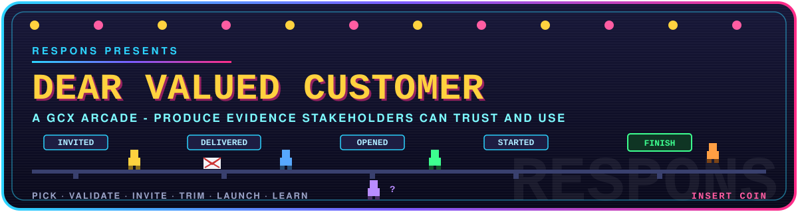

# Dear Valued Customer

**Code name: Respons.** A retro arcade training game for Microsoft
Instrument Managers in GCX (Global Customer Experience). It teaches
how to raise customer satisfaction survey response rates: the share
of invited customers who click through the invitation email and
complete the questionnaire.

Practice space only. Simulated audiences, simulated results, no real
customer data, no real sends.

## Play it

The game is a single self contained HTML file. No build step, no
server code, no accounts.

- Local: open `site/index.html` in any modern browser.
- Hosted: deploy the `site/` folder to any static host (see
  `docs/deployment.md`).

A round takes 3 to 5 minutes: pick an audience, prepare the list,
tune the invite, trim the questionnaire, launch, watch the sprites,
read the Drop-off Detective, go again.

## The game in one screen

- **Three levers, always on screen.** AUDIENCE (who gets invited),
  INVITATION (wording and click through appeal), QUESTIONNAIRE
  (length, complexity, answerability). Every action belongs to one.
- **Two budgets.** Goodwill, the audience's patience with you, shown
  as a breaker panel. Credits, one pool of 120 per level shared
  across all your attempts, spent across list preparation and
  execution. You cannot afford everything; that is the game.
- **Two ways forward.** After a round: TRY AGAIN and continue the
  level on the credits you have left, improving the process until
  you win or the money runs out, or NEW GAME for a fresh random
  questionnaire. It sounds like a cabinet too: original chiptune
  BGM and event effects, all synthesized inside the file.
- **A funnel you can watch.** Forty persona sprites walk SENT,
  DELIVERED, OPENED, STARTED, FINISH. They bounce, wander off, stall
  on questions they cannot answer, or jump at the finish line.
- **Three scores.** Response rate first, data quality second,
  Insight Value third, and all three gate the win: beat the rate
  target with a gutted or off-agenda survey and you still lose.
  The 64 question bank deals a different instrument every game,
  and a coach, a field guide, and a one-lesson recap teach the
  trade as you play.
- **Six levels.** First Send, The Split (A/B testing), The
  Stakeholder, The Tired List, 45 Languages, The Big Quarter.

## Documentation

| Doc | What it covers |
| --- | --- |
| `docs/player-guide.md` | How to play: controls, budget price table, scoring, level list, tips |
| `docs/requirements-game-design.md` | Requirements and Game Design Description v1.0: the design contract |
| `docs/mechanics-update-v1.1.md` | The v1.1 addendum: budget, bounces, BrightVerify validation, sender reputation, data quality failures |
| `docs/gameplay-concepts.md` | The brainstorm record behind the design |
| `docs/game-concept.md` | The earlier Circuit Breaker framing, kept for history |
| `docs/development.md` | How the single file game is put together, the simulation model, and how to tune balance |
| `docs/deployment.md` | How to put `site/` on a subdomain, including Azure Static Web Apps |
| `CHANGELOG.md` | Version history |

## Repo layout

```text
assets/banner.svg      Cabinet banner (this README)
site/index.html        The game. One file, deployable as is
docs/                  Design, play, development, deployment docs
```

## Status

- v1.0 POC (2026-10-30): one round, verified balance checks.
- v1.1 (2026-10-31): named **Dear Valued Customer**, polish pass,
  budget, deliverability, and data quality mechanics.
- v1.2 (2026-10-31): full six level campaign, A/B test move,
  deployment ready single file, this documentation set.

Internal training concept. Not a Microsoft product, not affiliated
with any survey platform. Survey results inside the game are
simulated and labeled as such.
